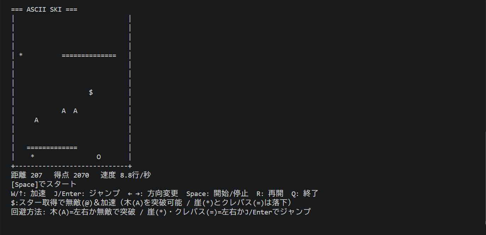

# ASCII SKI（改良版）

## ゲームの概要
ターミナル上で遊べるリアルタイム入力・スクロール型のスキーアクションゲームです。  
左右へ自動的に滑り降りるプレイヤーを操作し、迫りくる木・崖・クレバスを回避しながら、無敵スターを活用してより長い距離とハイスコアを目指します。

## 動作環境
- **OS**: Windows 10 / 11（Windowsの非ブロッキング入力モジュール `msvcrt` および ANSIエスケープシーケンスを使用しているため）
- **Python**: Python 3.x（標準ライブラリのみ使用）
- **推奨ターミナル**: VS Code 内蔵ターミナル / Windows Terminal

## インストール方法
外部ライブラリのインストールは不要です。Python がインストールされた Windows 環境であればそのまま動作します。

```bash
git clone [https://github.com/g026c1157/ski-game_kairyou.git](https://github.com/g026c1157/ski-game_kairyou.git)
cd ski-game_kairyou
```

## 起動方法
VS Code のターミナル、または Windows Terminal でプロジェクトフォルダーを開き、以下のコマンドを実行します（※ファイル名は環境に合わせて変更してください）。

```bash
python ski_game.py
py ski_game.py
```

## 操作方法

### キー操作一覧
| キー | 操作内容 |
| :--- | :--- |
| `←` / `A` | 左方向へ移動方向を変更 |
| `→` / `D` | 右方向へ移動方向を変更 |
| `W` / `↑` | **加速**（3ターンの間、滑走スピードが2倍になる） |
| `J` / `Enter` | **ジャンプ**（3ターンの間、空中に跳び上がる） |
| `Space` | ゲームの開始 / 一時停止 |
| `R` | ゲームオーバー後のリスタート（最初からやり直し） |
| `Q` / `Esc` | ゲーム終了 |

### ゲームルールと記号の意味
| 記号 | 名称・種類 | 特徴・対処法 |
| :---: | :--- | :--- |
| `O` | プレイヤー（通常） | 左右の壁にぶつかるとゲームオーバー |
| `V` | プレイヤー（加速中） | `W` / `↑` 入力後3ターンの間、移動速度が2倍 |
| `^` | プレイヤー（ジャンプ中） | 崖（`*`）とクレバス（`=`）を飛び越えられる（木は飛び越え不可） |
| `@` | プレイヤー（無敵中） | `$` 取得後25ターンの間、加速＋木（`A`）を破壊して突破可能（残り8ターン以下で `O` と点滅） |
| `A` | 木（障害物） | ジャンプでも飛び越え不可。左右移動で避けるか、無敵状態（`@`）で突破する |
| `*` | 崖（障害物） | 左右移動で避けるか、ジャンプ（`J` / `Enter`）で飛び越える（無敵中でも落下） |
| `=` | クレバス（横長の穴） | 横幅10〜15マスの大きな穴。左右移動で避けるか、ジャンプで飛び越える（無敵中でも落下） |
| `$` | 無敵スター（アイテム） | 取得すると25ターンの間、無敵＆自動加速状態になる |

## 追加・改良した機能

### 改良機能01：加速（ダッシュ）機能（`W` / `↑`）
- `W` キーまたは上矢印キー `↑` を押すことで、3ターンの間速度が2倍になり、自機の表示が `V` に変化するようにしました。
- 上矢印キーを認識できるよう、`get_key()` の特殊キー判定（`"H"`）を追加しています。

### 改良機能02：ジャンプ機能（`J` / `Enter`）と地形「クレバス（`=`）」の追加
- `J` キーまたは `Enter` キーで3ターンの間ジャンプ（自機表示 `^`）ができるようにしました。
- 新たな障害物として横幅10〜15マスの「クレバス（`=`）」をランダム生成する処理を追加しました。
- 障害物ごとに特性を分け、「崖（`*`）とクレバス（`=`）はジャンプで飛び越えられるが、木（`A`）はジャンプでも飛び越えられない」という戦略性を持たせています。

### 改良機能03：無敵スター（`$`）と状態表示・点滅予告の実装
- コース上に低確率で無敵スター（`$`）が出現するようにしました。
- 取得すると25ターンの間、自機が `@` に変化して自動加速し、木（`A`）にぶつかってもミスにならず突破できます（ただし崖 `*` やクレバス `=` には無敵中でも落下します）。
- 効果終了のタイミングが分かるよう、残り8ターン以下になると `@` と `O` が交互に点滅する演出を加えました。

### 改良機能04：画面下部のルール・回避方法ガイドの表示
- 初見のプレイヤーでも追加要素や当たり判定の違いが直感的に分かるよう、操作説明の下にアイテム効果と障害物ごとの回避方法を2行で常時表示するようにしました。

## スクリーンショット


## 既知の問題・制限事項
- Windows専用の `msvcrt` モジュールおよび Windows 10/11 の ANSI エスケープシーケンスを使用しているため、macOS や Linux 環境では動作しません。
- ターミナルの表示高さ（行数）が狭い場合、画面上部のタイトル枠がスクロールして見切れることがあります。その場合はターミナルの高さを広げて実行してください。

## クレジット
- ベースプログラム：講義「プログラミング演習1 / Web技術演習」配布教材『ASCIIスキー』